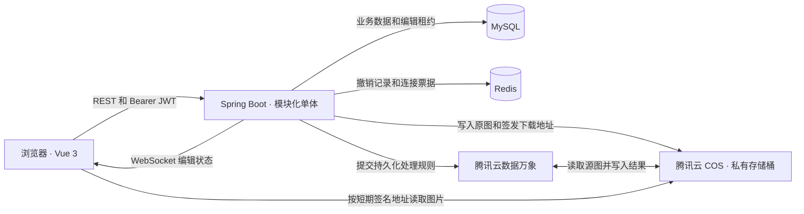

# ImageCloud 技术栈与整体架构

ImageCloud 是面向个人和团队的私有云图库。用户可以上传和查看图片，进行裁剪、旋转、缩放、压缩与缩略图生成。团队成员按空间角色共同管理图片，并实时看到当前编辑者。同一张图片在同一时刻只授予一个编辑会话保存权限。

## 技术基线与依赖

| 层次 | 技术选型 | 职责 |
| --- | --- | --- |
| Web 前端 | Vue 3、TypeScript、Vite、Vue Router | 页面与路由、上传和工作区交互。使用浏览器 `fetch` 调用 API，使用 Canvas 预览裁剪和旋转。 |
| Java 后端 | Java 17、Spring Boot 3.5.16、Spring MVC、Maven Wrapper | 以模块化单体部署，提供 REST API 和 WebSocket 编辑状态推送。 |
| 接口文档 | springdoc-openapi 2.10.0、Knife4j UI 4.5.0 | springdoc 生成 `/v3/api-docs` 的 OpenAPI 3.0 文档，Knife4j 在 `/doc.html` 展示文档。 |
| 业务数据 | MySQL、MySQL Connector/J、MyBatis-Plus 3.5.18 的 Spring Boot 3 Starter | 保存账号、空间和成员、图片元数据及版本、编辑租约和图片操作记录。 |
| 临时状态 | Spring Data Redis、Redis | 保存 JWT 撤销记录和 WebSocket 一次性连接票据。 |
| 图片文件 | 腾讯云 COS 私有存储桶、数据万象（CI） | COS 保存原图与派生图。数据万象执行常规图片编辑和优化，并将结果写回 COS。 |

后端版本以仓库根目录的 `pom.xml` 为准。Spring Boot 3.5.16 支持 Java 17，MyBatis-Plus 使用对应的 Spring Boot 3 Starter。Vue 前端采用 Vite 构建。参考 [Spring Boot 系统要求](https://docs.spring.io/spring-boot/3.5/system-requirements.html)、[MyBatis-Plus 安装文档](https://baomidou.com/en/getting-started/install/) 和 [Vue 官方快速开始](https://vuejs.org/guide/quick-start.html)。

| 引入条件 | Maven 依赖 | 用途与兼容性 |
| --- | --- | --- |
| 实现 JWT 登录与 API 认证 | `org.springframework.boot:spring-boot-starter-oauth2-resource-server` | 复用 Spring Security 的 JWT 签发和验签组件。由 Spring Boot 3.5.16 管理版本。 |
| 实现编辑状态推送 | `org.springframework.boot:spring-boot-starter-websocket` | 使用 Spring MVC 的 WebSocket 支持，由 Spring Boot 3.5.16 管理版本。 |
| 实现 COS 存取与图片处理 | `com.qcloud:cos_api` | 使用官方 Java SDK 完成对象读写、签名与数据万象持久化处理。接入时固定验证过的 SDK 版本。 |

引入 COS SDK 时，用 Java 17 和现有 Spring Boot 基线验证编译与依赖解析，并验证私有桶上传、预签名下载和数据万象持久化处理。核对桶所在地域和存储桶类型对数据万象的支持。参考 [Spring Boot Starter 列表](https://docs.spring.io/spring-boot/3.5/reference/using/build-systems.html)、[COS Java SDK 快速入门](https://intl.cloud.tencent.com/zh/document/product/436/10199)、[Java SDK 图片持久化处理](https://cloud.tencent.com/document/product/436/55377) 和 [腾讯云图片基础处理](https://cloud.tencent.com/document/product/460/47483)。

组件库、全局状态库和图片编辑库按实际需求评估。新增依赖前先检查 JDK、浏览器 API 和现有库是否覆盖需求，并记录依赖用途及兼容性。

## 系统关系与模块职责



| 业务模块 | 职责 |
| --- | --- |
| 账号认证 | 管理账号身份、JWT 签发和撤销，以及 WebSocket 连接票据。 |
| 空间与成员 | 管理个人空间、团队空间和成员角色，提供按空间校验权限的服务。 |
| 图片管理 | 管理上传、查询、下载授权、图片元数据和版本发布。通过空间模块校验权限，通过图片处理模块调用云服务。 |
| 图片处理 | 封装 COS 和数据万象 SDK。负责对象存取、签名、处理规则转换和云端对象清理。 |
| 编辑协作 | 管理图片编辑租约和 WebSocket 订阅。向图片管理模块提供保存所需的租约校验。 |

Java 包先按技术层组织，同一层内再按业务划分，例如 `controller.auth`、`service.auth` 和 `dto.picture`。MyBatis 接口统一放在 `mapper` 及其子包下。

跨模块共用的工具类放在 `common` 包，例如 `ResultUtil` 和 `ThrowUtils`。

跨模块操作通过所属模块的服务接口完成。HTTP 控制器和 WebSocket 处理器负责接入与协议转换，业务模块负责权限和状态变更，图片处理模块集中管理云端交互。

## REST API 响应

通用响应使用 `Response<T>` 表示，`code` 为整数业务响应码，`data` 承载接口数据，`message` 为可选提示。`data` 和 `message` 为 `null` 时省略对应的 JSON 字段。

控制器使用 `ResultUtil.ok()` 或 `ResultUtil.ok(data)` 生成 `code` 为 `200` 的响应体。`ResultUtil.error(errorCode)` 将业务错误码和默认提示写入响应体。

### 错误响应

JSON 响应体中的 `code` 为四位整数，前三位使用 HTTP 状态编号表示错误类别，末位 `0` 表示通用错误，`1`–`9` 用于细分场景。客户端按响应体中的 `code` 处理具体错误，`message` 用于展示。Spring MVC 和认证层的错误响应采用相同的结构。

全局异常处理器返回业务错误码和消息，HTTP 状态沿用框架默认行为。MVC 请求解析、校验等错误映射到下表对应的错误码。未预期异常写入服务端日志，响应体返回 `5000` 和通用提示。

| 错误码前三位 | 通用错误码 | 细分错误码 |
| --- | --- | --- |
| `400` | `4000` 请求格式或参数类型错误 | `4001` 参数校验失败 |
| `401` | `4010` 缺少访问令牌 | `4011` 登录凭据错误，`4012` 访问令牌无效 |
| `403` | `4030` 权限不足 | |
| `404` | `4040` 资源不存在 | |
| `405` | `4050` 请求方法不受支持 | |
| `409` | `4090` 资源状态冲突 | `4091` 编辑租约冲突，`4092` 图片版本冲突 |
| `413` | `4130` 请求体或上传文件过大 | |
| `415` | `4150` 请求媒体类型不受支持 | |
| `500` | `5000` 服务端内部错误 | |
| `503` | `5030` 服务暂时不可用 | |

裁剪参数超出允许范围时，响应体示例如下。

```json
{
  "code": 4001,
  "message": "请求参数校验失败"
}
```

## 关键数据流

### 认证与空间权限

应用登录成功后签发短期 RS256 JWT，REST API 通过 `Authorization: Bearer` 接收令牌并验证签名、签发者、受众、有效期和撤销状态。注销时将令牌标识写入 Redis，保留至令牌到期，并关闭该令牌关联的连接。WebSocket 使用受 JWT 保护的 REST 接口签发短期票据，握手时在 Redis 原子消费票据，并检查对应 JWT 的有效期和撤销状态。连接最长持续到该 JWT 到期。参考 [Spring Security JWT 文档](https://docs.spring.io/spring-security/reference/servlet/oauth2/resource-server/jwt.html) 和 [Spring WebSocket 文档](https://docs.spring.io/spring-framework/reference/web/websocket/server.html)。

个人空间由空间所有者访问。团队的查看者可以查看和下载，编辑者还可以上传、编辑和优化图片，所有者另有成员管理权限。后端在读取、写入或订阅时按图片所属空间校验当前权限。成员失去访问权限时撤销对应的订阅。

### 上传、编辑与图片读取

1. 浏览器通过 REST 上传。后端校验空间权限、文件内容和大小，生成对象键并将原图写入私有 COS 桶，写入成功后提交图片记录。对象键由服务端生成，MySQL 保存对象键和图片元数据。
2. 缩略图使用预设处理规则。用户可在 Canvas 中预览编辑效果，并提交裁剪、旋转、缩放或压缩参数。后端校验参数范围并转换为数据万象规则。数据万象为缩略图、优化图和编辑结果生成独立对象，保留原图。结果对象写入成功后，图片管理模块在 MySQL 中提交新版本。
3. 上传和处理在发起云端写入前记录待完成操作及目标对象键。处理失败时可按操作记录重试。云端对象生成后，如果数据库提交失败或保存条件失效，由图片管理模块协调图片处理模块重试提交或清理对象。清理前核对对象是否已被版本引用，避免误删已发布结果。图库只展示已提交的版本。
4. 用户请求原图或派生图时，后端先检查访问权限，再按对应对象键签发短期下载 URL。原图与派生图分别读取，已签发 URL 的有效期由其签名决定。参考 [腾讯云图片持久化处理](https://cloud.tencent.com/document/product/436/55377) 和 [COS 预签名访问](https://intl.cloud.tencent.com/zh/document/product/436/45243)。

### 编辑权与实时状态

1. 编辑者通过 REST 获取、续期或释放编辑租约。MySQL 使用按图片的条件更新授予租约，租约绑定编辑会话并设有到期时间。会话关闭时可主动释放，连接中断后租约可自然过期。
2. 保存请求包含编辑租约和编辑所基于的图片版本。发起云端处理前校验权限与租约。发布时用 MySQL 条件更新同时核对租约持有人、到期时间和图片版本，并在同一事务中提交新版本。冲突时返回当前状态供用户重新加载。
3. WebSocket 向有权订阅的成员推送占用、释放和到期状态。客户端重连后通过 REST 重新读取当前租约及图片版本。默认部署一个后端实例，多实例部署时可复用 Redis Pub/Sub 跨节点分发事件，MySQL 仍负责判定当前编辑权。

## 验收场景

| 场景 | 预期结果 |
| --- | --- |
| 非成员访问另一团队空间内的图片 | REST 拒绝读取和签发下载 URL，WebSocket 拒绝订阅该图片的编辑状态。 |
| 获授权用户编辑或压缩图片后下载 | 原图和派生图分别通过各自的短期签名地址访问，原图内容保持完整。 |
| 两名团队成员同时申请编辑同一张图片 | 只有一个会话拿到租约，另一方收到占用状态。租约失效或版本变化后，旧会话无法提交结果。 |
| 数据万象失败，或结果写入 COS 后数据库提交失败 | 处理可重试，图库继续展示上一已提交版本，未被引用的结果可安全回收。 |
