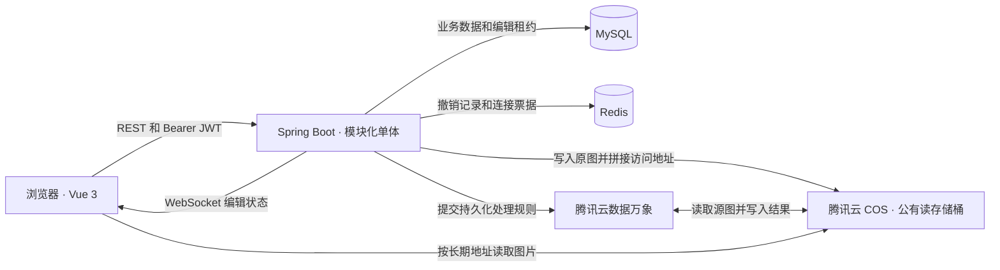

# ImageCloud 技术栈与整体架构

ImageCloud 是面向个人和团队的私有云图库。用户可以上传和查看图片，进行裁剪、旋转、缩放、压缩与缩略图生成。团队成员按空间角色共同管理图片，并实时看到当前编辑者。同一张图片在同一时刻只授予一个编辑会话保存权限。

## 技术基线与依赖

| 层次 | 技术选型 | 职责 |
| --- | --- | --- |
| Web 前端 | Vue 3、TypeScript、Vite、Vue Router | 页面与路由、上传和工作区交互。使用浏览器 `fetch` 调用 API，使用 Canvas 预览裁剪和旋转。 |
| Java 后端 | Java 17、Spring Boot 3.5.16、Spring MVC、Maven Wrapper | 以模块化单体部署，提供 REST API 和 WebSocket 编辑状态推送。 |
| 接口文档 | springdoc-openapi 2.10.0、Knife4j UI 4.5.0 | springdoc 生成 `/v3/api-docs` 的 OpenAPI 3.0 文档，Knife4j 在 `/doc.html` 展示文档。 |
| 业务数据 | MySQL、MySQL Connector/J、MyBatis-Plus 3.5.18 的 Spring Boot 3 Starter | 保存账号、空间和成员、图片元数据及版本、编辑租约和图片操作记录。 |
| 临时状态 | Spring Data Redis、Redis | 保存 JWT 撤销记录和 WebSocket 一次性连接票据。 |
| 图片文件 | 腾讯云 COS 公有读存储桶、数据万象（CI） | COS 保存原图与派生图，对象以长期地址访问。数据万象执行常规图片编辑和优化，并将结果写回 COS。 |

后端版本以仓库根目录的 `pom.xml` 为准。Spring Boot 3.5.16 支持 Java 17，MyBatis-Plus 使用对应的 Spring Boot 3 Starter。Vue 前端采用 Vite 构建。参考 [Spring Boot 系统要求](https://docs.spring.io/spring-boot/3.5/system-requirements.html)、[MyBatis-Plus 安装文档](https://baomidou.com/en/getting-started/install/) 和 [Vue 官方快速开始](https://vuejs.org/guide/quick-start.html)。

| 引入条件 | Maven 依赖 | 用途与兼容性 |
| --- | --- | --- |
| 实现账号注册 | `org.springframework.security:spring-security-crypto`、`org.springframework.boot:spring-boot-starter-validation` | 使用版本化的 PBKDF2-HMAC-SHA256 密码哈希和 Jakarta Bean Validation。两项依赖均由 Spring Boot 3.5.16 管理版本。 |
| 实现数据库分页 | `com.baomidou:mybatis-plus-jsqlparser:3.5.18` | 提供 MyBatis-Plus 分页拦截器，版本与启动器一致，适配项目 Java 17。 |
| 实现登录与 JWT 签发 | `org.springframework.security:spring-security-oauth2-jose` | 使用 Spring Security 的 JWT 签发组件。由 Spring Boot 3.5.16 管理版本。 |
| 实现 Bearer API 认证 | `org.springframework.boot:spring-boot-starter-oauth2-resource-server` | 接入 Spring Security 的 Bearer JWT 认证链。由 Spring Boot 3.5.16 管理版本。 |
| 实现编辑状态推送 | `org.springframework.boot:spring-boot-starter-websocket` | 使用 Spring MVC 的 WebSocket 支持，由 Spring Boot 3.5.16 管理版本。 |
| 接入 COS 客户端 | `com.qcloud:cos_api:5.6.227` | 按官方快速入门声明 HTTPS 客户端单例，由 Spring 在容器关闭时调用 `shutdown()`。主配置通过占位变量读取密钥和地域，开发值填写在 `application-dev.yaml` 的 `imagecloud.cos` 下。对象读写、地址拼接与数据万象持久化处理后续通过该 SDK 实现。 |

引入 COS SDK 时，用 Java 17 和现有 Spring Boot 基线验证编译与依赖解析，并验证公有读桶上传、长期地址访问和数据万象持久化处理。核对桶所在地域和存储桶类型对数据万象的支持。参考 [Spring Boot Starter 列表](https://docs.spring.io/spring-boot/3.5/reference/using/build-systems.html)、[COS Java SDK 快速入门](https://intl.cloud.tencent.com/zh/document/product/436/10199)、[Java SDK 图片持久化处理](https://cloud.tencent.com/document/product/436/55377) 和 [腾讯云图片基础处理](https://cloud.tencent.com/document/product/460/47483)。

组件库、全局状态库和图片编辑库按实际需求评估。新增依赖前先检查 JDK、浏览器 API 和现有库是否覆盖需求，并记录依赖用途及兼容性。

## 前端登录后布局

顶部账号菜单提供 `/profile` 本人主页与 `/settings/account` 账户设置。资料修改通过本人接口完成，成功后复用会话查询更新页面及顶部昵称；密码修改成功后清空密码表单并保留当前会话。头像上传返回固定公开的 `avatarUrl` 与 `avatarOriginalUrl`，先预览，保存资料时成对提交，取消修改丢弃整个上传草稿并恢复已存压缩头像。刷新或重新登录后通过本人 ID 查询公开资料恢复头像。保存后新发头像查询，并按请求代次和会话令牌隔离响应，防止旧请求覆盖新保存的头像。点击已存头像通过原图接口加载；未保存头像直接预览本次上传的原图，并标明未保存。查看界面支持关闭、Escape 和失败重试，关闭或换号后忽略迟到响应。顶部头像查看按钮与账号菜单入口分开，均可使用键盘操作。

本人主页与账户设置支持性别、个人简介、邮箱、手机号和出生年月，管理员仅在编辑已有账号时可修改这些字段。历史缺省或 null 回填后未改动的字段不提交，性别用 0 清除，文本用空字符串清除，年月按本地当前年月校验。公开用户主页使用 `/profile/:id`，本人主页提供按 ID 访问入口；公开接口响应在前端按字段白名单投影，不保留和渲染手机号。管理员图片管理位于 `/admin/images`，菜单和路由仅允许 ADMIN，验证服务重试保留该目标。

登录后的页面共用顶部品牌与账号菜单、可收起的左侧导航和右侧内容区。所有用户默认进入 `/workspace` 我的图库，`/explore` 公共图库与 `/teams` 团队空间目前展示占位内容。图库搜索在功能接入前显示禁用状态。

业务时间在接口中使用无时区的本地日期时间字符串，例如 `2026-11-19T15:30:00`。VIP 到期日期使用本地日期字符串 `YYYY-MM-DD`，到期当天仍然有效，次日起视为已到期；查询范围直接提交本地日期时间值。数据库连接通过 `connectionTimeZone=LOCAL` 和 `forceConnectionTimeZoneToSession=true` 跟随应用本地时区，使数据库默认时间与应用编辑时间一致。前端按本地日期时间展示和提交，前端使用 `normalizeBusinessDateTime` 独立校验日历、补齐省略的秒并保留小数，`businessTimeKey` 只用于等值比较，`localCurrentMonth` 提供出生年月上限。时间组件可见文本和属性均保留秒小数，不附加时区。JWT 签发、有效期及会话的令牌到期字段遵循协议时间戳语义。

用户表和图片表的主键由应用侧雪花算法生成（MyBatis-Plus `IdType.ASSIGN_ID`），数据库列不再自增，存量自增 ID 保持不变。雪花 ID 为 19 位 Long，超出 JavaScript 安全整数范围，接口响应中所有以 `id` 结尾的 Long 字段统一序列化为字符串，前端按字符串处理主键。

管理员额外显示 `/admin/users` 用户管理导航。该页面提供分页列表、按账号搜索、按 ID 查询以及新增、编辑、只读详情抽屉，并保留删除确认。账号及创建时间范围搜索区分输入草稿和已提交条件，搜索后回到第一页，翻页及写入后的刷新保留已提交条件，重置后显示全量用户。路由在进入登录后布局前确认会话，管理接口继续独立执行权限校验。移动端导航通过菜单展开，退出入口统一放在顶部账号菜单。

## 系统关系与模块职责



| 业务模块 | 职责 |
| --- | --- |
| 账号认证 | 管理账号身份、JWT 签发和撤销，以及 WebSocket 连接票据。 |
| 空间与成员 | 管理个人空间、团队空间和成员角色，提供按空间校验权限的服务。 |
| 图片管理 | 管理上传、查询、下载授权、图片元数据和版本发布。通过空间模块校验权限，通过图片处理模块调用云服务。 |
| 图片处理 | 封装 COS 和数据万象 SDK。负责对象存取、地址拼接、处理规则转换和云端对象清理。 |
| 编辑协作 | 管理图片编辑租约和 WebSocket 订阅。向图片管理模块提供保存所需的租约校验。 |

Java 包按技术层组织。管理员用户接口放在 `AdminController`，类级路径为 `/api/admin`，方法级路径为 `/users`。图片相关接口统一放在 `ImageController`，类级路径为 `/api/images`：用户头像接口使用 `/avatars`，管理员图片管理接口使用 `/admin` 下的子路径。控制器放在 `controller` 包下，数据模型沿用现有 `models` 层级，`models.entity` 仅存放数据库表实体。服务接口放在 `service` 包下，实现类放在 `service.impl`，调用方依赖服务接口。请求 DTO 放在 `models.dto` 及其业务子包，返回 VO 放在 `models.vo` 及其业务子包，图片上传结果类 `ImageUploadVo`、`AdminImageUploadVo` 放在 `models.vo.image`，通用响应封装放在 `response` 包下。MyBatis 接口放在 `mapper` 及其子包下。包路径调整按用户明确指定执行，并保留用户手动移动的结果。

跨模块共用的工具类放在 `common` 包，例如 `ResultUtil` 和 `ThrowUtils`。

跨模块操作通过所属模块的服务接口完成。HTTP 控制器和 WebSocket 处理器负责接入与协议转换，业务模块负责权限和状态变更，图片处理模块集中管理云端交互。

图片处理模块内部通过 `utils.CosUtils.uploadImage(MultipartFile, String)` 上传图片，第二个参数为存储前缀，例如 `avatars/`、`images/` 或 `spaces/{spaceId}/`。方法校验原始文件名后缀白名单 `jpg、jpeg、png、webp、gif、bmp、tif、tiff`，统一后缀大小写，在前缀下生成 `yyyyMMdd_uuid.后缀` 对象键，日期使用服务器本地日期，图片大小上限为 20MB。底层 `uploadFile` 为私有方法，复用 COS 客户端并关闭上传流。上传请求设置 `Pic-Operations.is_pic_info=1`，并添加持久化规则 `imageMogr2/format/webp/quality/80`，在同一桶、同一目录生成 `yyyyMMdd_uuid_compressed.webp` 展示图，原图使用独立对象键。压缩质量取原图质量和 80 的较小值。以数据万象返回的实际格式、宽高、质量、主色调、方向和帧数为准，通过 `models.vo.image.ImageUploadVo` 一并返回原图 `originalObjectKey`、展示图 `thumbnailObjectKey`、原始文件名和原图大小。调用方列表展示使用压缩图，详情展示使用原图。格式统一为小写，原图信息或压缩结果缺失、无效时抛出业务异常，压缩结果须匹配目标对象键、WebP 格式及非零大小。存储桶由主配置 `cos.bucket` 引用 `application-dev.yaml` 中的 `imagecloud.cos.bucket`。调用方负责权限校验，桶所在地域需支持数据万象。

`CosUtils.downloadFile(String)` 使用官方 `GetObjectRequest` 和流式下载接口，返回已打开的 `InputStream`。接口调用方在下载前校验访问权限，取得流后设置 `Content-Type` 和 `Content-Disposition: attachment` 等响应头，通过 try-with-resources 将内容写入 HTTP 响应并关闭输入流以释放 COS 连接。工具类将获取对象时的 SDK 异常转换为业务异常，流读取和响应写入阶段的 I/O 异常由调用方处理。

## REST API 响应

Spring MVC 为 `/api/**` 接口启用跨域访问，跨域认证使用 `Authorization` 请求头中的 Bearer 令牌。

控制器的 REST 方法由通用日志切面记录调用开始、结束或失败，包含 HTTP 方法、路径、接口方法、操作者 ID、业务码和耗时。应用包日志默认使用 INFO，参数校验和认证拦截失败由全局异常处理器记录。业务写入结果由所属服务补充，密码、令牌和完整请求响应体等敏感数据排除在日志外。

通用响应使用 `Response<T>` 表示，`code` 为整数业务响应码，`data` 承载接口数据，`message` 为可选提示。`data` 和 `message` 为 `null` 时省略对应的 JSON 字段。

控制器使用 `ResultUtil.ok()` 或 `ResultUtil.ok(data)` 生成 `code` 为 `200` 的响应体。`ResultUtil.error(errorCode)` 将业务错误码和默认提示写入响应体。

### 错误响应

JSON 响应体中的 `code` 为四位整数，前三位使用 HTTP 状态编号表示错误类别，末位 `0` 表示通用错误，`1`–`9` 用于细分场景。客户端按响应体中的 `code` 处理具体错误，`message` 用于展示。Spring MVC 和认证层的错误响应采用相同的结构。

全局异常处理器返回业务错误码和消息，HTTP 状态沿用框架默认行为。MVC 请求解析、校验等错误映射到下表对应的错误码。未预期异常写入服务端日志，响应体返回 `5000` 和通用提示。

| 错误码前三位 | 通用错误码 | 细分错误码 |
| --- | --- | --- |
| `400` | `4000` 请求格式或参数类型错误 | `4001` 参数校验失败 |
| `401` | `4010` 缺少访问令牌 | `4011` 登录凭据错误，`4012` 访问令牌无效 |
| `403` | `4030` 权限不足 | |
| `404` | `4040` 资源不存在 | |
| `405` | `4050` 请求方法不受支持 | |
| `409` | `4090` 资源状态冲突 | `4091` 编辑租约冲突，`4092` 图片版本冲突 |
| `413` | `4130` 请求体或上传文件过大 | |
| `415` | `4150` 请求媒体类型不受支持 | |
| `500` | `5000` 服务端内部错误 | |
| `503` | `5030` 服务暂时不可用 | |

裁剪参数超出允许范围时，响应体示例如下。

```json
{
  "code": 4001,
  "message": "请求参数校验失败"
}
```

## 关键数据流

### 认证与空间权限

`user_account` 使用唯一登录账号和密码哈希。平台角色为 `USER`、`VIP` 或 `ADMIN`。VIP 权益要求角色为 `VIP` 且会员尚未到期，到期日期使用年月日，到期当天仍然有效。应用每天零点执行定时任务，把到期日期早于当天（即已过期）的 VIP 账号改为 `USER` 并清空到期日期，执行失败或停机后由下一次运行补齐。头像展示图单独设置为公开读，保存并返回不含过期签名的固定 HTTPS URL。逻辑删除沿用 MyBatis-Plus 全局配置。业务时间字段使用 `LocalDateTime` 和 MySQL `DATETIME(3)` 原值保存、查询与返回。数据库通过 `DEFAULT CURRENT_TIMESTAMP(3)` 生成 `created_at`，通过 `DEFAULT (created_at)` 初始化 `edit_time`，通过 `DEFAULT CURRENT_TIMESTAMP(3)` 和 `ON UPDATE CURRENT_TIMESTAMP(3)` 维护 `update_time`。实体映射排除创建时间和更新时间的插入、更新赋值。用户及管理员编辑资料或修改密码时在更新语句中显式设置 `edit_time = CURRENT_TIMESTAMP(3)`，三类审计时间使用同一数据库时钟，逻辑删除通过 MyBatis-Plus 更新删除标记并由数据库刷新更新时间。已有历史日期时间按原值保留。

公开注册接口 `POST /api/auth/register` 接收 `account`、`password` 和可选的 `displayName`。账号去除首尾空白后为 3–16 位 ASCII 字母、数字或下划线，保留并区分大小写。密码为 8–32 位，由后端生成带算法标识的密码哈希。新账号默认是正常状态的普通用户。数据库按区分大小写的规则约束登录名唯一性，包含逻辑删除的账号。注册成功返回用户 ID 和保存的账号。

公开登录接口 `POST /api/auth/login` 先校验请求字段，密码长度与注册一致，为 8–32 个字符。再按大小写精确查询未删除的账号，使用注册时的密码编码器对比密码，并校验账号状态。找不到账号时使用占位哈希执行密码校验，各类凭据失败统一返回 `4011`。成功时使用配置的 RSA 私钥签发 RS256 JWT，默认有效期为 30 分钟。响应返回令牌、有效期和当前用户的基础资料，包含实时计算的 VIP 权益状态，以及 本地日期时间格式的 `editTime` 和 `updateTime`。新账号的 `editTime` 初始为创建时间，历史账号的空值继续兼容。

Spring MVC 认证拦截器覆盖 `/api/**`，匿名业务入口为 `POST /api/auth/register` 和 `POST /api/auth/login`，CORS 预检沿用跨域配置。拦截器独立解析 `Authorization: Bearer`，校验 RS256 签名、签发者、受众、有效期、用户 ID 和令牌 ID，并检查 Redis 撤销记录。缺少令牌返回业务码 `4010`，令牌失效返回 `4012`，无法确认 Redis 撤销状态时返回 `5030`。

认证通过后，拦截器将 JWT 中的操作者 ID 绑定到请求线程，在线程处理结束时清理。Controller 方法可通过 `@AuthCheck` 声明最低平台角色，切面按线程中的操作者 ID 查询数据库，校验最新账号状态、角色和 VIP 到期时间。账号不存在或已停用时返回业务码 `4012`。`USER` 允许所有平台角色，`VIP` 允许会员未到期的 `VIP` 和 `ADMIN`，`ADMIN` 仅允许管理员。角色不足时返回业务码 `4030`。`GET /api/auth/session` 由认证服务查询最新账号资料，确认账号有效后返回 `data.user` 和 UTC 到期时间 `data.expiresAt`。空间和图片的资源权限由所属业务服务校验。

`GET /api/admin/users/{id}` 要求管理员权限。接口可查询正常和停用的用户，并返回账号原始值、头像字段、角色、状态和本地日期时间字段。响应白名单排除密码和密码哈希。`GET /api/users/{id}` 允许登录用户查询正常用户的登录账号、公开身份、昵称和可访问的头像地址，路径 ID 只用于定位用户，响应不返回主键。公开身份为 `USER`、`VIP` 或 `ADMIN`，VIP 到期后按普通用户返回。公开资料中的头像字段返回已保存的固定 URL，未设置头像时为空。逻辑删除的账号在两个接口均返回业务码 `4040`，公开资料接口对停用账号也返回 `4040`。`GET /api/heartbeat` 也要求有效登录态。

`POST /api/images/avatars` 要求有效登录态和正常账号，使用 multipart/form-data 的 `file` 字段上传图像。复用 `CosUtils.uploadImage`，所有用户头像统一使用 `avatars/` 存储前缀，文件名由工具生成 UUID，图像上限 20MB，整个 multipart 请求上限 21MB。上传后将本次原图和压缩头像对象的 ACL 均设置为 PublicRead，返回压缩头像 `avatarUrl` 和原图 `avatarOriginalUrl` 两个 SDK 生成的公开固定 HTTPS URL，可保存并长期展示。响应设置 `Cache-Control: no-store`，日志仅记录用户 ID 和对象键。公开读设置失败时返回 `5030`，上传和删除操作仍通过后端权限控制。

`user_account.avatar_url` 保存压缩头像固定 URL，`avatar_original_url` 保存原图固定 URL。上传成功返回 `data.avatarUrl` 和 `data.avatarOriginalUrl`，前端保存个人资料时提交这两个字段，省略或 null 的字段保持原值，空字符串可清空。

`GET /api/images/avatars/{id}/original` 允许登录用户查询正常且未删除用户的原始头像，直接读取用户表 `avatar_original_url` 并返回 `Response<String>`。前端点击头像时读取 `data` 中的固定 URL 并加载。无效 ID 返回 `4000` 或 `4001`，账号不可用或原图字段为空时返回 `4040`。

用户表新增可空的 `gender`、`bio`、`email`、`phone_number`、`birth_month`。API 字段为 `gender`、`bio`、`email`、`phoneNumber`、`birthMonth`。性别为 0 未设置、1 男、2 女，自我介绍最多 500 字符，邮箱最多 254 字符并校验邮箱格式，手机号为 6–20 位数字且可带前缀 +，出生年月采用 YYYY-MM 且不能晚于当前年月。

`GET /api/auth/session` 的 `data.user` 和登录结果返回本人这五个字段，供个人主页展示。`PATCH /api/users/me` 允许本人修改这些字段，null 或省略保持原值，文本空字符串可清空。管理员详情和分页返回全部五项，管理员可通过已有 `PATCH /api/admin/users` 修改。按 ID 查询他人资料的 `GET /api/users/{id}` 返回性别、自我介绍、邮箱、出生年月，手机号仅本人和管理员可见。管理员及用户本人编辑均刷新 edit_time。

`POST /api/users/search` 供登录用户按昵称片段分页搜索正常且未删除的账号，昵称与分页参数通过 JSON 请求体提交并继承 `PageRequest` 的 `page`、`pageSize`，昵称去除首尾空白后不能为空且最多 12 个字符，响应包含 `records`、`total`、`page`、`pageSize`。当前页内昵称完全一致的候选排在最前，其次是有审核通过图片的用户。每个候选包含 ID、账号、昵称、头像地址，以及该用户最新三张审核通过图片的压缩图长期地址，没有可用图片时为空列表；预览图在一次 IN 查询中由窗口函数按上传者分组各取最新三张。个人主页顶栏使用该接口按昵称定位用户主页：只有一个匹配时直接进入主页，多个匹配时按三列卡片展示，滚动到底继续加载下一页。

`PATCH /api/users/me` 更新本人资料，目标 ID 从已验证登录态取得，请求 `UserUpdateRequest` 接收账号、昵称、头像 URL 及上述五项资料。省略或为 null 的字段保持原值，昵称和头像允许空字符串清空。账号保留大小写，头像校验 HTTPS URL 格式，空更新返回 `4001`。仅复制白名单字段，并刷新 `edit_time`，数据库自动维护 `update_time`。

`PATCH /api/users/me/password` 使用独立的 `UserPasswordUpdateRequest`，要求 `oldPassword` 和 `newPassword` 均为 8–32 个字符，保留密码原始输入。原密码错误返回 `4011`，新密码经现有编码器哈希后保存。更新条件包含当前用户 ID、原密码哈希和正常状态，以防并发覆盖已经变更的密码，冲突返回 `4090`。本人资料更新通过 `@AuthCheck` 验证账号有效性，修改密码仅依赖认证拦截器校验登录态，无需额外平台角色。两个本人更新接口均为单条写入自动提交，成功仅返回 `{"code":200}`。

`POST /api/admin/users` 复用公开注册的账号和唯一约束规则。请求字段包括 `account`、`displayName`、`platformRole`、`status` 和 `vipExpiresAt`。服务端将初始密码统一设置为 `12345678`，通过现有密码编码器哈希后保存。管理员可指定角色、状态和 VIP 到期日期，角色和状态默认 `USER` 与 `ACTIVE`。首个管理员由部署人员在数据库里将指定账号的 `platform_role` 设为 `ADMIN`。`PATCH /api/admin/users` 从请求体的必填正整数 `id` 读取目标用户，仅应用本次提交的非空资料字段，包括 `account`、`displayName`、`platformRole`、`status` 和 `vipExpiresAt`。管理员可将其他用户的角色设为 `ADMIN`，修改自己时返回 `4030`。资料字段省略或传 `null` 均保留旧值，至少提交一个非空资料字段。普通用户资料更新采用单条更新自动提交，通过影响行数判断目标是否存在，通过 Hutool `BeanUtil.copyProperties` 忽略空值，只将请求提交的字段写入更新实体，再调用 `updateById`。业务时间字段直接按 `LocalDateTime` 复制，VIP 到期日期按 `LocalDate` 复制。角色与到期日期必须成对出现：将角色设为 VIP 时必须同时提交到期日期，未声明 VIP 身份时提交到期日期会被拒绝；将角色改为非 VIP 时清除已保存的到期日期。创建成功返回 `{"code":200}`，采用单条插入自动提交。更新成功仅返回 `{"code":200}`，更新前后均不查询目标用户。

`DELETE /api/admin/users/{id}` 直接调用 MyBatis-Plus `deleteById`，沿用逻辑删除配置，`update_time` 由 MySQL 自动维护，管理员删除自己的账号时返回 `4030`。修改和删除的操作者 ID 均来自鉴权通过的当前线程。删除后原登录名仍由唯一索引保留，旧令牌在会话查询及角色鉴权时被拒绝。`GET /api/admin/users` 使用 MyBatis-Plus 的 `Page`、`selectPage` 和 MySQL 分页拦截器按 ID 倒序查询未删除用户，总数与分页 SQL 由插件生成，包含停用账号，返回 `records`、`total`、`page` 和 `pageSize`。接口通过 URL 查询参数绑定 `UserQueryRequest`，该类继承通用 `PageRequest` 中的 `page` 和 `pageSize`。Controller 和 Service 均接收查询对象。用户条件包括精确匹配的 `id`、`platformRole`、`status`，字面包含匹配的 `account`、`displayName`，以及包含边界的创建时间范围 `createdAtStart`、`createdAtEnd`。省略或空白的条件不参与筛选，多个条件按 AND 组合。账号去除首尾空白并保留大小写，非空片段允许 1–32 位 ASCII 字母、数字或下划线，以兼容历史账号。昵称片段最多 64 个字符。LIKE 参数显式转义 `!`、`%`、`_` 并通过参数绑定查询。时间范围接收无时区的 ISO 8601 本地日期时间并直接查询，上限不能早于下限。相同的 Wrapper 用于总数与记录查询，约束不合法返回 `4001`，类型或时间格式错误返回 `4000`。页码默认 1，每页默认 20 条，最多 100 条。超出末页时返回空记录及实际总数。列表与管理详情复用 `AdminUserVo` 及其字段白名单。

注销只撤销当前令牌，在 Redis 原子写入令牌 ID 和有效期，并发布 `AccessTokenRevokedEvent`，供协作模块按令牌 ID 关闭连接。注销请求与其他受保护接口统一校验 JWT 和撤销记录。已注销令牌再次调用返回业务码 `4012`，并发重复撤销也通过 Redis 原子写入结果拒绝，撤销通知只在首次成功时发布。撤销记录保留到令牌停止被接受时。WebSocket 使用受 JWT 保护的 REST 接口签发短期票据，握手时在 Redis 原子消费票据，并检查对应 JWT 的有效期和撤销状态。连接最长持续到该 JWT 到期。参考 [Spring Security JWT 文档](https://docs.spring.io/spring-security/reference/servlet/oauth2/resource-server/jwt.html) 和 [Spring WebSocket 文档](https://docs.spring.io/spring-framework/reference/web/websocket/server.html)。

个人空间由空间所有者访问。团队的查看者可以查看和下载，编辑者还可以上传、编辑和优化图片，所有者另有成员管理权限。后端在读取、写入或订阅时按图片所属空间校验当前权限。成员失去访问权限时撤销对应的订阅。

### 上传、编辑与图片读取

图片主表使用 `image`，实体为 `com.blank.imagecloud.models.entity.Image`，最终建表结构维护在 `src/main/resources/schema.sql`，后续表结构调整直接修改对应的 `CREATE TABLE`。主表保存可为空的所属空间（为空表示图片不属于任何空间）、上传者、名称说明、单个大分类、JSON 标签数组、原始文件名，以及原图 `original_object_key` 和展示用压缩图 `thumbnail_object_key`。上传返回字段 `originalObjectKey`、`thumbnailObjectKey` 与实体保持一致。名称最多 16 个字符，说明最多 128 个字符，分类最多 16 个字符，标签单项最多 20 个字符，原图格式最多 10 个字符，格式和尺寸以数据万象结果为准。主表还保存审核状态 `audit_status`（0 未审核、1 通过、2 不通过，新图片默认 0）、审核信息 `audit_message`、审核人 `auditor_id` 和本地审核时间 `audit_time`，未审核时后三项为空。`vip_only` 为 1 时要求有效 VIP，并继续校验空间权限。Redis Set 记录点赞用户，主表 `like_count` 保存允许延迟的数量快照，具体点赞接口和同步流程后续实现。图片主表的创建时间由数据库生成，审核时间由应用写入本地日期时间，`edit_time` 初始为创建时间（数据库默认值），用户或管理员编辑时刷新，`update_time` 由 MySQL 自动维护。当前主表省略 `version_no` 和 `mime_type`，后续版本发布及冲突校验通过独立版本结构设计，与编辑协作模块对齐后实现。

1. 浏览器通过 REST 上传。后端校验空间权限、文件内容和大小，生成对象键并将原图写入 COS 桶，写入成功后提交图片记录。对象键由服务端生成，MySQL 保存对象键和图片元数据。
2. 缩略图使用预设处理规则。用户可在 Canvas 中预览编辑效果，并提交裁剪、旋转、缩放或压缩参数。后端校验参数范围并转换为数据万象规则。数据万象为缩略图、优化图和编辑结果生成独立对象，保留原图。结果对象写入成功后，图片管理模块在 MySQL 中提交新版本。
3. 管理员先独立上传图片获取 URL，再提交图片信息。新增或更新记录失败时返回错误，由调用方重新上传后再提交。图片主表通过单条 SQL 自动提交，图库展示已成功保存的图片记录。
4. 用户请求原图或派生图时，后端先检查访问权限，再按对应对象键拼接长期访问地址。存储桶为公有读，地址不包含签名参数，可长期直接使用。参考 [腾讯云图片持久化处理](https://cloud.tencent.com/document/product/436/55377)。

### 管理员图片接口

`/api/images/admin` 下的接口均要求 `@AuthCheck(PlatformRole.ADMIN)`，操作者 ID 取自当前登录态。

- `POST /api/images/admin/uploads` 独立接收 multipart/form-data 的 `file`，最多 20MB。对象统一使用服务端生成的 `images/` 前缀，空间归属在提交图片信息时确定。返回 `imageUrl`（原图）和 `thumbnailUrl`（压缩图），均为长期地址，响应设置 `Cache-Control: no-store`。
- `POST /api/images/admin` 使用 JSON 提交必填的 `imageUrl`、`name` 和可选的 `spaceId`、`description`、`category`、字符串数组 `tags`、`vipOnly`。后端校验 URL 指向当前 COS 桶的图片原图路径，提取对象键后通过 SDK 读取原图与压缩图对象、原文件名元数据和数据万象图片属性，数据库保存对象键及这些真实属性。历史对象缺少原文件名元数据时使用对象文件名。图片信息通过单条插入自动提交，上传者为当前管理员，审核直接通过，成功仅返回业务码 200。保存失败由调用方重新上传后提交。
- `DELETE /api/images/admin/{id}` 通过 MyBatis-Plus 按 ID 逻辑删除图片记录，不删除 COS 上的原图和压缩图对象，`update_time` 由 MySQL 自动刷新，创建、编辑及审核时间保留。
- `GET /api/images/admin/{id}` 返回管理视角详情，包含图片元数据、`uploaderId`、审核状态、审核信息、审核人和审核时间，以及原图与压缩图的长期访问地址。地址由 COS 客户端按对象键拼接，存储桶为公有读；响应只返回地址，不暴露对象键。响应设置 `Cache-Control: no-store`。
- `GET /api/images/admin` 按条件分页查询图片，与用户条件查询同构：名称和分类字面包含匹配，图片 ID、空间 ID、上传用户 ID、审核状态和 VIP 限制精确匹配，创建时间支持包含边界的范围筛选，多个条件同时生效，省略条件不参与筛选。结果按图片 ID 倒序，每条记录均为补全长期访问地址的详情，返回 `records`、`total`、`page`、`pageSize`。
- `PATCH /api/images/admin/audit` 使用 JSON 提交审核结果，请求体包含目标图片 `id`、审核结论 `auditStatus` 和审核信息 `auditMessage`。审核结论只接受通过（`1`）和不通过（`2`），不通过时审核信息必填，通过时忽略提交内容并清空历史审核信息。审核人 ID 取自登录态，不接受客户端提交。允许对已审核图片改判，每次审核刷新审核人和审核时间。接口以单条更新自动提交，影响行数为零返回 4040，成功仅返回业务码 200。
- `PATCH /api/images/admin/{id}` 使用 JSON 局部更新，省略或 null 保持原值，说明和分类可传空字符串清空，`tags: []` 清空标签。可选 `imageUrl` 指向已上传原图，后端从 COS 和数据万象读取属性以替换图片。空更新返回 4001，更新影响行数为零返回 4040。图片元数据及对象引用通过单条更新自动提交。管理员编辑保留审核字段并刷新 `edit_time`，`update_time` 由 MySQL 自动刷新，成功仅返回业务码 200。

### 编辑权与实时状态

1. 编辑者通过 REST 获取、续期或释放编辑租约。MySQL 使用按图片的条件更新授予租约，租约绑定编辑会话并设有到期时间。会话关闭时可主动释放，连接中断后租约可自然过期。
2. 保存请求包含编辑租约和编辑所基于的图片版本。发起云端处理前校验权限与租约。发布时用 MySQL 条件更新同时核对租约持有人、到期时间和图片版本，并在同一事务中提交新版本。冲突时返回当前状态供用户重新加载。
3. WebSocket 向有权订阅的成员推送占用、释放和到期状态。客户端重连后通过 REST 重新读取当前租约及图片版本。默认部署一个后端实例，多实例部署时可复用 Redis Pub/Sub 跨节点分发事件，MySQL 仍负责判定当前编辑权。

## 验收场景

| 场景 | 预期结果 |
| --- | --- |
| 非成员访问另一团队空间内的图片 | REST 拒绝读取和签发下载 URL，WebSocket 拒绝订阅该图片的编辑状态。 |
| 获授权用户编辑或压缩图片后下载 | 原图和派生图分别通过各自的长期地址访问，原图内容保持完整。 |
| 两名团队成员同时申请编辑同一张图片 | 只有一个会话拿到租约，另一方收到占用状态。租约失效或版本变化后，旧会话无法提交结果。 |
| 数据万象失败，或结果写入 COS 后数据库提交失败 | 处理可重试，图库继续展示上一已提交版本，未被引用的结果可安全回收。 |
