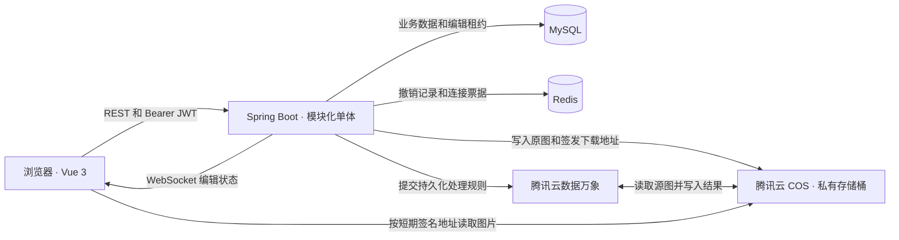

# ImageCloud 技术栈与整体架构

ImageCloud 是面向个人和团队的私有云图库。用户可以上传和查看图片，进行裁剪、旋转、缩放、压缩与缩略图生成。团队成员按空间角色共同管理图片，并实时看到当前编辑者。同一张图片在同一时刻只授予一个编辑会话保存权限。

## 技术基线与依赖

| 层次 | 技术选型 | 职责 |
| --- | --- | --- |
| Web 前端 | Vue 3、TypeScript、Vite、Vue Router | 页面与路由、上传和工作区交互。使用浏览器 `fetch` 调用 API，使用 Canvas 预览裁剪和旋转。 |
| Java 后端 | Java 17、Spring Boot 3.5.16、Spring MVC、Maven Wrapper | 以模块化单体部署，提供 REST API 和 WebSocket 编辑状态推送。 |
| 接口文档 | springdoc-openapi 2.10.0、Knife4j UI 4.5.0 | springdoc 生成 `/v3/api-docs` 的 OpenAPI 3.0 文档，Knife4j 在 `/doc.html` 展示文档。 |
| 业务数据 | MySQL、MySQL Connector/J、MyBatis-Plus 3.5.18 的 Spring Boot 3 Starter | 保存账号、空间和成员、图片元数据及版本、编辑租约和图片操作记录。 |
| 临时状态 | Spring Data Redis、Redis | 保存 JWT 撤销记录和 WebSocket 一次性连接票据。 |
| 图片文件 | 腾讯云 COS 私有存储桶、数据万象（CI） | COS 保存原图与派生图。数据万象执行常规图片编辑和优化，并将结果写回 COS。 |

后端版本以仓库根目录的 `pom.xml` 为准。Spring Boot 3.5.16 支持 Java 17，MyBatis-Plus 使用对应的 Spring Boot 3 Starter。Vue 前端采用 Vite 构建。参考 [Spring Boot 系统要求](https://docs.spring.io/spring-boot/3.5/system-requirements.html)、[MyBatis-Plus 安装文档](https://baomidou.com/en/getting-started/install/) 和 [Vue 官方快速开始](https://vuejs.org/guide/quick-start.html)。

| 引入条件 | Maven 依赖 | 用途与兼容性 |
| --- | --- | --- |
| 实现账号注册 | `org.springframework.security:spring-security-crypto`、`org.springframework.boot:spring-boot-starter-validation` | 使用版本化的 PBKDF2-HMAC-SHA256 密码哈希和 Jakarta Bean Validation。两项依赖均由 Spring Boot 3.5.16 管理版本。 |
| 实现数据库分页 | `com.baomidou:mybatis-plus-jsqlparser:3.5.18` | 提供 MyBatis-Plus 分页拦截器，版本与启动器一致，适配项目 Java 17。 |
| 实现登录与 JWT 签发 | `org.springframework.security:spring-security-oauth2-jose` | 使用 Spring Security 的 JWT 签发组件。由 Spring Boot 3.5.16 管理版本。 |
| 实现 Bearer API 认证 | `org.springframework.boot:spring-boot-starter-oauth2-resource-server` | 接入 Spring Security 的 Bearer JWT 认证链。由 Spring Boot 3.5.16 管理版本。 |
| 实现编辑状态推送 | `org.springframework.boot:spring-boot-starter-websocket` | 使用 Spring MVC 的 WebSocket 支持，由 Spring Boot 3.5.16 管理版本。 |
| 接入 COS 客户端 | `com.qcloud:cos_api:5.6.227` | 按官方快速入门声明 HTTPS 客户端单例，由 Spring 在容器关闭时调用 `shutdown()`。主配置通过占位变量读取密钥和地域，开发值填写在 `application-dev.yaml` 的 `imagecloud.cos` 下。对象读写、签名与数据万象持久化处理后续通过该 SDK 实现。 |

引入 COS SDK 时，用 Java 17 和现有 Spring Boot 基线验证编译与依赖解析，并验证私有桶上传、预签名下载和数据万象持久化处理。核对桶所在地域和存储桶类型对数据万象的支持。参考 [Spring Boot Starter 列表](https://docs.spring.io/spring-boot/3.5/reference/using/build-systems.html)、[COS Java SDK 快速入门](https://intl.cloud.tencent.com/zh/document/product/436/10199)、[Java SDK 图片持久化处理](https://cloud.tencent.com/document/product/436/55377) 和 [腾讯云图片基础处理](https://cloud.tencent.com/document/product/460/47483)。

组件库、全局状态库和图片编辑库按实际需求评估。新增依赖前先检查 JDK、浏览器 API 和现有库是否覆盖需求，并记录依赖用途及兼容性。

## 前端登录后布局

登录后的页面共用顶部品牌与账号菜单、可收起的左侧导航和右侧内容区。所有用户默认进入 `/workspace` 我的图库，`/explore` 公共图库与 `/teams` 团队空间目前展示占位内容。图库搜索在功能接入前显示禁用状态。

用户管理列表和详情中的时间按浏览器本地时区展示到秒，并标明时区。VIP 到期时间按本地时间输入后转换为 UTC 提交，未修改时沿用接口原值。

管理员额外显示 `/admin/users` 用户管理导航。该页面提供分页列表、按账号搜索、按 ID 查询以及新增、编辑、只读详情抽屉，并保留删除确认。账号搜索区分输入草稿和已提交条件，搜索后回到第一页，翻页及写入后的刷新保留已提交条件，重置后显示全量用户。路由在进入登录后布局前确认会话，管理接口继续独立执行权限校验。移动端导航通过菜单展开，退出入口统一放在顶部账号菜单。

## 系统关系与模块职责



| 业务模块 | 职责 |
| --- | --- |
| 账号认证 | 管理账号身份、JWT 签发和撤销，以及 WebSocket 连接票据。 |
| 空间与成员 | 管理个人空间、团队空间和成员角色，提供按空间校验权限的服务。 |
| 图片管理 | 管理上传、查询、下载授权、图片元数据和版本发布。通过空间模块校验权限，通过图片处理模块调用云服务。 |
| 图片处理 | 封装 COS 和数据万象 SDK。负责对象存取、签名、处理规则转换和云端对象清理。 |
| 编辑协作 | 管理图片编辑租约和 WebSocket 订阅。向图片管理模块提供保存所需的租约校验。 |

Java 包按技术层组织。控制器和数据库实体分别直接放在 `controller` 和 `entity` 包下。服务接口放在 `service` 包下，实现类放在 `service.impl`，调用方依赖服务接口。请求 DTO 放在 `dto` 及其业务子包，接口的业务返回类放在 `vo` 包下，通用响应封装放在 `response` 包下。MyBatis 接口放在 `mapper` 及其子包下。

跨模块共用的工具类放在 `common` 包，例如 `ResultUtil` 和 `ThrowUtils`。

跨模块操作通过所属模块的服务接口完成。HTTP 控制器和 WebSocket 处理器负责接入与协议转换，业务模块负责权限和状态变更，图片处理模块集中管理云端交互。

## REST API 响应

Spring MVC 为 `/api/**` 接口启用跨域访问，跨域认证使用 `Authorization` 请求头中的 Bearer 令牌。

通用响应使用 `Response<T>` 表示，`code` 为整数业务响应码，`data` 承载接口数据，`message` 为可选提示。`data` 和 `message` 为 `null` 时省略对应的 JSON 字段。

控制器使用 `ResultUtil.ok()` 或 `ResultUtil.ok(data)` 生成 `code` 为 `200` 的响应体。`ResultUtil.error(errorCode)` 将业务错误码和默认提示写入响应体。

### 错误响应

JSON 响应体中的 `code` 为四位整数，前三位使用 HTTP 状态编号表示错误类别，末位 `0` 表示通用错误，`1`–`9` 用于细分场景。客户端按响应体中的 `code` 处理具体错误，`message` 用于展示。Spring MVC 和认证层的错误响应采用相同的结构。

全局异常处理器返回业务错误码和消息，HTTP 状态沿用框架默认行为。MVC 请求解析、校验等错误映射到下表对应的错误码。未预期异常写入服务端日志，响应体返回 `5000` 和通用提示。

| 错误码前三位 | 通用错误码 | 细分错误码 |
| --- | --- | --- |
| `400` | `4000` 请求格式或参数类型错误 | `4001` 参数校验失败 |
| `401` | `4010` 缺少访问令牌 | `4011` 登录凭据错误，`4012` 访问令牌无效 |
| `403` | `4030` 权限不足 | |
| `404` | `4040` 资源不存在 | |
| `405` | `4050` 请求方法不受支持 | |
| `409` | `4090` 资源状态冲突 | `4091` 编辑租约冲突，`4092` 图片版本冲突 |
| `413` | `4130` 请求体或上传文件过大 | |
| `415` | `4150` 请求媒体类型不受支持 | |
| `500` | `5000` 服务端内部错误 | |
| `503` | `5030` 服务暂时不可用 | |

裁剪参数超出允许范围时，响应体示例如下。

```json
{
  "code": 4001,
  "message": "请求参数校验失败"
}
```

## 关键数据流

### 认证与空间权限

`user_account` 使用唯一登录账号和密码哈希。平台角色为 `USER`、`VIP` 或 `ADMIN`。VIP 权益要求角色为 `VIP` 且会员尚未到期。头像保存私有 COS 对象的原始 URL，返回用户资料时签发短期访问地址。逻辑删除沿用 MyBatis-Plus 全局配置。时间字段统一使用 UTC 毫秒时间。应用初始化 `created_at` 和 `edit_time` 为同一时间，用户自行修改账号信息时刷新 `edit_time`。数据库通过 `DEFAULT CURRENT_TIMESTAMP(3)` 和 `ON UPDATE CURRENT_TIMESTAMP(3)` 维护 `update_time`。现有应用设置 `updateTime` 的代码继续保留，MyBatis-Plus 字段映射将其排除出插入和更新赋值。返回值需要更新时间时允许使用应用生成的当前时间，接受其与数据库实际写入时间略有差异。管理员和系统修改资料时保留 `edit_time`，逻辑删除由 MySQL 自动维护 `update_time`。

公开注册接口 `POST /api/auth/register` 接收 `account`、`password` 和可选的 `displayName`。账号去除首尾空白后为 3–16 位 ASCII 字母、数字或下划线，保留并区分大小写。密码为 8–32 位，由后端生成带算法标识的密码哈希。新账号默认是正常状态的普通用户。数据库按区分大小写的规则约束登录名唯一性，包含逻辑删除的账号。注册成功返回用户 ID 和保存的账号。

公开登录接口 `POST /api/auth/login` 先校验请求字段，密码长度与注册一致，为 8–32 个字符。再按大小写精确查询未删除的账号，使用注册时的密码编码器对比密码，并校验账号状态。找不到账号时使用占位哈希执行密码校验，各类凭据失败统一返回 `4011`。成功时使用配置的 RSA 私钥签发 RS256 JWT，默认有效期为 30 分钟。响应返回令牌、有效期和当前用户的基础资料，包含实时计算的 VIP 权益状态，以及 UTC 格式的 `editTime` 和 `updateTime`。新账号的 `editTime` 初始为创建时间，历史账号的空值继续兼容。

Spring MVC 认证拦截器覆盖 `/api/**`，匿名业务入口为 `POST /api/auth/register` 和 `POST /api/auth/login`，CORS 预检沿用跨域配置。拦截器独立解析 `Authorization: Bearer`，校验 RS256 签名、签发者、受众、有效期、用户 ID 和令牌 ID，并检查 Redis 撤销记录。缺少令牌返回业务码 `4010`，令牌失效返回 `4012`，无法确认 Redis 撤销状态时返回 `5030`。

认证通过后，拦截器将 JWT 中的操作者 ID 绑定到请求线程，在线程处理结束时清理。Controller 方法可通过 `@AuthCheck` 声明最低平台角色，切面按线程中的操作者 ID 查询数据库，校验最新账号状态、角色和 VIP 到期时间。账号不存在或已停用时返回业务码 `4012`。`USER` 允许所有平台角色，`VIP` 允许会员未到期的 `VIP` 和 `ADMIN`，`ADMIN` 仅允许管理员。角色不足时返回业务码 `4030`。`GET /api/auth/session` 由认证服务查询最新账号资料，确认账号有效后返回 `data.user` 和 UTC 到期时间 `data.expiresAt`。空间和图片的资源权限由所属业务服务校验。

`GET /api/admin/users/{id}` 要求管理员权限。接口可查询正常和停用的用户，并返回账号原始值、头像字段、角色、状态和 UTC 时间字段。响应白名单排除密码和密码哈希。`GET /api/users/{id}` 允许登录用户查询正常用户的 ID、昵称和可访问的头像地址。COS 头像签发接入前，公开头像字段为 `null`。逻辑删除的账号在两个接口均返回业务码 `4040`，公开资料接口对停用账号也返回 `4040`。`GET /api/heartbeat` 也要求有效登录态。

`POST /api/admin/users` 复用公开注册的账号和唯一约束规则。请求字段包括 `account`、`displayName`、`platformRole`、`status` 和 `vipExpiresAt`。服务端将初始密码统一设置为 `12345678`，通过现有密码编码器哈希后保存。管理员可指定角色、状态和 VIP 到期时间，角色和状态默认 `USER` 与 `ACTIVE`。首个管理员由部署人员在数据库里将指定账号的 `platform_role` 设为 `ADMIN`。`PATCH /api/admin/users` 从请求体的必填正整数 `id` 读取目标用户，仅应用本次提交的非空资料字段，包括 `account`、`displayName`、`platformRole`、`status` 和 `vipExpiresAt`。管理员可将其他用户的角色设为 `ADMIN`，修改自己时返回 `4030`。资料字段省略或传 `null` 均保留旧值，至少提交一个非空资料字段。普通用户资料更新采用单条更新自动提交，通过影响行数判断目标是否存在，通过 Hutool `BeanUtil.copyProperties` 忽略空值，只将请求提交的字段写入更新实体，再调用 `updateById`。日期复制显式转换为 UTC。本次请求将角色设为 VIP 时，必须同时提交到期时间。创建成功返回 `{"code":200}`，采用单条插入自动提交。更新成功仅返回 `{"code":200}`，更新前后均不查询目标用户。

`DELETE /api/admin/users/{id}` 直接调用 MyBatis-Plus `deleteById`，沿用逻辑删除配置，`update_time` 由 MySQL 自动维护，管理员删除自己的账号时返回 `4030`。修改和删除的操作者 ID 均来自鉴权通过的当前线程。删除后原登录名仍由唯一索引保留，旧令牌在会话查询及角色鉴权时被拒绝。`GET /api/admin/users` 使用 MyBatis-Plus 的 `Page`、`selectPage` 和 MySQL 分页拦截器按 ID 倒序查询未删除用户，总数与分页 SQL 由插件生成，包含停用账号，返回 `records`、`total`、`page` 和 `pageSize`。接口通过 URL 查询参数绑定 `UserQueryRequest`，该类继承通用 `PageRequest` 中的 `page` 和 `pageSize`。Controller 和 Service 均接收查询对象。用户条件包括精确匹配的 `id`、`platformRole`、`status`，字面包含匹配的 `account`、`displayName`，以及包含边界的创建时间范围 `createdAtStart`、`createdAtEnd`。省略或空白的条件不参与筛选，多个条件按 AND 组合。账号去除首尾空白并保留大小写，非空片段允许 1–32 位 ASCII 字母、数字或下划线，以兼容历史账号。昵称片段最多 64 个字符。LIKE 参数显式转义 `!`、`%`、`_` 并通过参数绑定查询。时间范围接收带时区的 ISO 8601 时间并转换为 UTC，上限不能早于下限。相同的 Wrapper 用于总数与记录查询，约束不合法返回 `4001`，类型或时间格式错误返回 `4000`。页码默认 1，每页默认 20 条，最多 100 条。超出末页时返回空记录及实际总数。列表与管理详情复用 `AdminUserVo` 及其字段白名单。

注销只撤销当前令牌，在 Redis 原子写入令牌 ID 和有效期，并发布 `AccessTokenRevokedEvent`，供协作模块按令牌 ID 关闭连接。注销请求与其他受保护接口统一校验 JWT 和撤销记录。已注销令牌再次调用返回业务码 `4012`，并发重复撤销也通过 Redis 原子写入结果拒绝，撤销通知只在首次成功时发布。撤销记录保留到令牌停止被接受时。WebSocket 使用受 JWT 保护的 REST 接口签发短期票据，握手时在 Redis 原子消费票据，并检查对应 JWT 的有效期和撤销状态。连接最长持续到该 JWT 到期。参考 [Spring Security JWT 文档](https://docs.spring.io/spring-security/reference/servlet/oauth2/resource-server/jwt.html) 和 [Spring WebSocket 文档](https://docs.spring.io/spring-framework/reference/web/websocket/server.html)。

个人空间由空间所有者访问。团队的查看者可以查看和下载，编辑者还可以上传、编辑和优化图片，所有者另有成员管理权限。后端在读取、写入或订阅时按图片所属空间校验当前权限。成员失去访问权限时撤销对应的订阅。

### 上传、编辑与图片读取

1. 浏览器通过 REST 上传。后端校验空间权限、文件内容和大小，生成对象键并将原图写入私有 COS 桶，写入成功后提交图片记录。对象键由服务端生成，MySQL 保存对象键和图片元数据。
2. 缩略图使用预设处理规则。用户可在 Canvas 中预览编辑效果，并提交裁剪、旋转、缩放或压缩参数。后端校验参数范围并转换为数据万象规则。数据万象为缩略图、优化图和编辑结果生成独立对象，保留原图。结果对象写入成功后，图片管理模块在 MySQL 中提交新版本。
3. 上传和处理在发起云端写入前记录待完成操作及目标对象键。处理失败时可按操作记录重试。云端对象生成后，如果数据库提交失败或保存条件失效，由图片管理模块协调图片处理模块重试提交或清理对象。清理前核对对象是否已被版本引用，避免误删已发布结果。图库只展示已提交的版本。
4. 用户请求原图或派生图时，后端先检查访问权限，再按对应对象键签发短期下载 URL。原图与派生图分别读取，已签发 URL 的有效期由其签名决定。参考 [腾讯云图片持久化处理](https://cloud.tencent.com/document/product/436/55377) 和 [COS 预签名访问](https://intl.cloud.tencent.com/zh/document/product/436/45243)。

### 编辑权与实时状态

1. 编辑者通过 REST 获取、续期或释放编辑租约。MySQL 使用按图片的条件更新授予租约，租约绑定编辑会话并设有到期时间。会话关闭时可主动释放，连接中断后租约可自然过期。
2. 保存请求包含编辑租约和编辑所基于的图片版本。发起云端处理前校验权限与租约。发布时用 MySQL 条件更新同时核对租约持有人、到期时间和图片版本，并在同一事务中提交新版本。冲突时返回当前状态供用户重新加载。
3. WebSocket 向有权订阅的成员推送占用、释放和到期状态。客户端重连后通过 REST 重新读取当前租约及图片版本。默认部署一个后端实例，多实例部署时可复用 Redis Pub/Sub 跨节点分发事件，MySQL 仍负责判定当前编辑权。

## 验收场景

| 场景 | 预期结果 |
| --- | --- |
| 非成员访问另一团队空间内的图片 | REST 拒绝读取和签发下载 URL，WebSocket 拒绝订阅该图片的编辑状态。 |
| 获授权用户编辑或压缩图片后下载 | 原图和派生图分别通过各自的短期签名地址访问，原图内容保持完整。 |
| 两名团队成员同时申请编辑同一张图片 | 只有一个会话拿到租约，另一方收到占用状态。租约失效或版本变化后，旧会话无法提交结果。 |
| 数据万象失败，或结果写入 COS 后数据库提交失败 | 处理可重试，图库继续展示上一已提交版本，未被引用的结果可安全回收。 |
